Text version

**Rohit Anish P**: B.Tech CSE · AI/ML, backend & IoT. Building AI-powered software and hardware.

Focus: AI/ML, Backend, IoT & Embedded, Cloud, Cybersecurity. Learning now: PostgreSQL, TypeScript, Backend Architecture, Cloud Computing, Cybersecurity.

- [onboardAI](https://github.com/rohit-anish/onboardAI): OnboardAI is an AI-powered developer onboarding platform that leverages Graphify and MCP to help new engineers understand software projects faster through automated architecture analysis, learning roadmaps, repository intelligence, and contextual project guidance.
- [Pragati](https://github.com/rohit-anish/Pragati): 
- [ASR-Perfector](https://github.com/rohit-anish/ASR-Perfector): 

